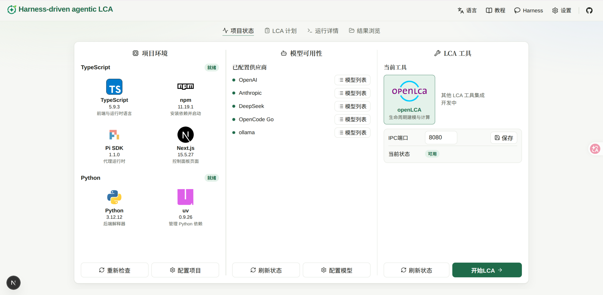

# Harness-driven LCA agents

多智能体在 harness 框架下进行合规化 **LCA（Life Cycle Assessment，生命周期评价）** 的项目。业务操作都在 Web 控制面板中完成。




## 前置要求

控制面板在 **Linux、macOS 和原生 Windows** 上运行。需要：

1. **[uv](https://docs.astral.sh/uv/getting-started/installation/)**：Python 包与项目管理。Python 3.12 由 uv 按项目配置安装，无需单独准备。
2. **[Node.js 22+](https://nodejs.org/)**（自带 npm）。
3. **[openLCA](https://www.openlca.org/download/)** 桌面客户端。使用前打开目标数据库，并启用 IPC Server（默认 `127.0.0.1:8080`）。
4. **Windows：** [Git for Windows](https://git-scm.com/download/win)。Agent 的 bash 工具使用它自带的 `bash.exe`。

## 启动

在仓库根目录执行：

```bash
npm start          # 等同 node src/scripts/start.mjs
```

脚本先同步 uv 与 Node.js 依赖、构建 pi-runtime（若没有 `.env`，会从 `.env.example` 复制一份），再依次启动后端 `fastapi`、`pi-runtime`、前端 `next`，全部就绪后返回；服务在后台常驻，关掉终端也不会停。浏览器打开终端打印的地址（默认 [http://127.0.0.1:3000](http://127.0.0.1:3000)）。

日常停止与重启：

```bash
npm run stop       # 停止后端、pi-runtime、前端，并清理本仓库残留的 MCP / 编排进程
npm run restart    # = stop + start，保证不会叠出第二个 pi-runtime
```

请用 `npm run stop` 停止，不要靠 Ctrl-C 或直接关终端。只有用 `npm start -- --foreground` 前台运行时，Ctrl-C 才会做与 `npm run stop` 完全相同的清理。

设置、计划、执行与结果查看，请在应用内打开 **教程**。

> [!CAUTION]
> 当前项目处于开发阶段，部分功能不太稳定，使用agent操作openLCA数据库时，建议使用 `复制/备份` 后版本的数据库进行连接。

