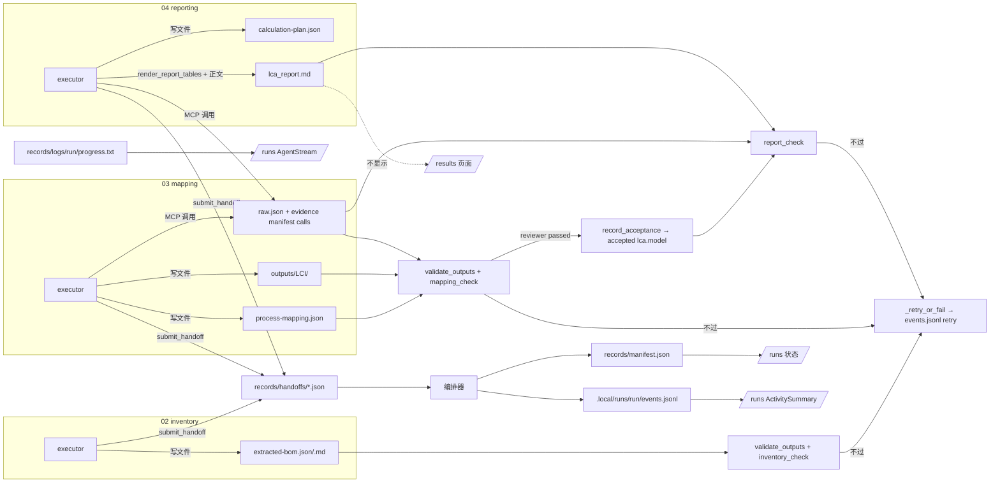

# 产物地图（ARTIFACTS）

> 长期迭代文档：记录每个阶段产出什么、放在哪、谁写谁读、GUI 怎么显示、什么时候失效。重构中每次改动产物的路径、写入方或渲染方式，都要同步更新本文，并在末尾“变更记录”里记一笔。
>
> 本版依据 `master`（`ee78fc0`）的代码核对，路径均相对项目根目录。P5（`spec_mcp`，分支 `refactor/p5-spec-channels`）尚未合并，相关变化只在“已知问题与待优化”里预告。

## 1. 总表

| 阶段 / 层级 | 产物 | 路径 | 格式 / 契约 | 写入方 | 校验 / 读取方 | GUI |
| --- | --- | --- | --- | --- | --- | --- |
| 01 reviewer | 交卷 handoff | `workspace/records/handoffs/01-intake-gate-reviewer-<n>.json` | JSON，`handoff.py` + `harness/specs/shared/lca-handoff-extension.schema.json` | agent 调 `lca_artifacts.submit_handoff` | 编排器 `advance()` | 仅事件流里的“已交卷”徽标 |
| 01 | 审查记录 | `workspace/records/reviews/01-intake-gate-<n>.md` | Markdown | 宿主 `write_review_note` | 人工 | 不显示 |
| 02 executor | BOM 清单 | `workspace/outputs/inventory/extracted-bom.json` | JSON，`harness/specs/02-inventory-extraction/extracted-bom.schema.json`，顶层 `items[]` | agent 直接写文件 | `validate_outputs`（schema）→ host action `inventory_check`（`checks.inventory_errors`）→ 02 reviewer；03、04 读取 | 不显示 |
| 02 executor | BOM 说明 | `workspace/outputs/inventory/extracted-bom.md` | Markdown（仅非空检查） | agent | `validate_outputs`、reviewer | 不显示 |
| 03 executor | 过程映射 | `workspace/outputs/inventory/process-mapping.json` | JSON，`harness/specs/03-dataset-mapping/process-mapping.schema.json`，顶层 `items[]` | agent | schema → `mapping_check`（`checks.mapping_errors`，含 provider 正式证据）→ reviewer；04 读取 | 不显示 |
| 03 executor | LCI 数据集 | `workspace/outputs/LCI/{flows,processes,product_systems}/` | openLCA JSON-LD 目录（只检查“是目录”） | agent | `mapping_check`、04 的 `import_lci` | 不显示 |
| 03 reviewer 通过后 | 模型验收记录 | `workspace/records/evidence/<run>/manifest.json` 的 `accepted["lca.model"]` | JSON | host action `record_acceptance` | 04 工具 `require_approved_model`、`get_rework_status` | 不显示 |
| 04 executor | 计算计划 | `workspace/outputs/reports/calculation-plan.json` | JSON（无 schema，`require_calculation_plan` 检查目标/方法各出现一次） | agent | `calculate_product_system` 前置检查；进入计算指纹 | 不显示 |
| 04 executor | LCA 报告 | `workspace/outputs/reports/lca_report.md` | Markdown，表格由 `render_report_tables` 生成 | MCP `lca_artifacts.render_report_tables` 生成表格 + agent 补正文 | `report_check`（证据 + 表格一致性 + 中文提示）→ reviewer | 不显示 |
| 各执行者 | MCP 调用原始结果 | `workspace/outputs/reports/runs/<run>/<stage>/<attempt>/<call_id>/raw.json` | JSON（领域结果全文） | MCP（`store.save_result`） | `checks.*` 经 manifest 引用 | 不显示 |
| 各执行者 | 调用清单 / 证据 | `workspace/records/evidence/<run>/manifest.json`（`calls[]`、`accepted{}`、`invalidations[]`） | JSON，每条带 `model_fingerprint`、`calculation_fingerprint` | MCP 追加 `calls`；宿主写 `accepted`、`invalidations` | `checks.py` 全部证据判断 | 不显示 |
| 检查结果 | 检查记录 | `workspace/records/evidence/<run>/checks/{inventory,mapping,report}.json` | JSON，含 `checker_version`、冻结的 `inputs` 指纹 | `checks.validate_for_run` | `validation_state`（过期则改写为 `stale`） | 不显示 |
| 03/04 | 导入预检回执 | `workspace/records/import-operations/preflights/<preflight_id>.json` | JSON | `control_openlca` MCP（`operations.py`） | `import_lci` 引用 preflight | 不显示 |
| 运行级 | 运行摘要 | `workspace/records/manifest.json` | JSON：`status`、`current_stage`、`status_reason`、`run_id` | 编排器 `publish_state` | `GET /api/workflow/manifest`、progress/activity 接口取 run_id | `/runs` 状态 |
| 运行级 | 检查点 | `workspace/records/orchestrator.sqlite`（+ `orchestrator.lock`） | SQLite | `CheckpointStore` | 断点续跑 | 不显示 |
| 运行级 | 运行配置指纹 | `workspace/records/evidence/<run>/runtime-config.json` | JSON：实现、rules、tools、knowledge、各阶段 spec + schema 的哈希 | 编排器 | 续跑时比对 | 不显示 |
| 运行级 | 上游返工记录 | `workspace/records/rework/upstream-<n>.json` | JSON：`stale_stages`、`reason`、`at` | 编排器 `_invalidate_stages` | 人工 | 不显示 |
| 运行级 | 进度文本 | `workspace/records/logs/<run>/progress.txt` | 带标签的文本块 | `pi_client` 活动处理 + 编排器 | `GET /api/workflow/progress` | `/runs` 的 `AgentStream` |
| 每个 turn | 排障快照 | `workspace/records/logs/<run>/<stage>/<assignment>#<attempt>/`：`prompt.md`、`session-config.json`、`argv.json`、`stdout.jsonl`、`session-ref.json`、`rendered-manifest.json` | 文本 / JSON | `core/agents/archive.py` | 人工排障 | 不显示 |
| 每个 turn | MCP 渲染配置 | `workspace/tmp/mcp-render/<run>/<stage>/<assignment>/` | 配置文件 | `archive.mcp_render_dir` | pi-runtime | 不显示 |
| 运行级 | 结构化事件 | `.local/runs/<run>/events.jsonl` | JSONL：worker 的 `tool_call`/`tool_result`/`text`/`turn_end`/`permission`；编排器的 `retry`/`rework_upstream`/`fault_injected`（`source: orchestrator`） | `pi_client` + 编排器 `_emit` | `GET /api/workflow/activity`（+ `/stream`） | `/runs` 的 `ActivitySummary` |
| 每个会话 | 路径拦截日志 | `.local/runs/<run>/pi/<session_key>.guard.jsonl` | JSONL：`tool`、`action`、`requested_path`、`resolved_path`、`reason` | pi-runtime `session_host.ts` | 人工 / 巡检 | 不显示 |

## 2. 按阶段说明

### 01-intake-gate（只有 reviewer）
- 输入：`harness/knowledge/plan/main_plan.md`。`spec.yaml` 中 `outputs: []`、`acceptance.checks: []`。
- 唯一产物是 reviewer 的 handoff 和宿主写的审查记录。

### 02-inventory-extraction
- executor 写 `extracted-bom.json`、`extracted-bom.md`，交 handoff。
- 宿主依次跑：`validate_outputs`（存在、非空、JSON、schema）→ `inventory_check`（`checks.inventory_errors`：行结构、来源 ID 是否在声明的知识来源中）。不过则 `_retry_or_fail`，在 `events.jsonl` 记 `retry`。
- reviewer 只读审查；reviewer 判 passed 后，`_guard_reviewer_passed` 会再跑一次产物契约和检查。

### 03-dataset-mapping
- executor 写 `process-mapping.json` 和 `outputs/LCI/`，并通过 `control_openlca` 调 `validate_providers_batch` / `preflight_import_lci`，调用结果进 `raw.json` 和 manifest。
- `mapping_check` 只认**当前模型指纹**下的 provider 验证调用；LCI 或 mapping 改动后旧证据作废。
- reviewer 通过后执行 `lifecycle.on_reviewer_passed` 的 `record_acceptance`，把冻结输入写进 `accepted["lca.model"]`。

### 04-openlca-reporting
- executor 写 `calculation-plan.json`，调 `import_lci`、`get_model_graph`、`calculate_product_system`（结果进 raw.json / manifest），再调 `render_report_tables` 生成 `lca_report.md` 的表格并补正文。
- `report_check` = `report_evidence_errors`（证据必须基于已验收模型、当前计算计划）+ `report_table_errors`（报告表格与证据一致）+ 语言提示。
- executor 交 failed 并带 `model_changed` / `rework_target_stage` / `rework_artifacts` 时，编排器核对后退回上游（见 §4）。

## 3. GUI 现状

| 页面 / 组件 | 接口 | 数据源 | 显示内容 |
| --- | --- | --- | --- |
| `/runs` → `ActivitySummary`（`components/runs/activity-summary.tsx`） | `GET /api/workflow/activity` | `.local/runs/<run>/events.jsonl` | 每个 assignment 的工具次数、错误数、最后工具、交卷状态 |
| `/runs` → `AgentStream`（`components/runs/agent-stream.tsx`） | `GET /api/workflow/progress` | `progress.txt`（准备阶段用启动器的内存文本） | Agent 正文、工具调用、编排器提示 |
| `/runs` 状态 | `GET /api/workflow/manifest` / progress | `workspace/records/manifest.json` | 运行状态、当前阶段、失败原因 |
| `/results`（`app/results/page.tsx`） | 无 | — | 只有一句写死的路径说明，**不展示任何产物** |
| `/harness` | `GET /api/harness/catalog`、`/api/harness/document` | `harness/` 下文件 | 规则、spec、schema 原文（是配置，不是产物） |

GUI **不显示**：BOM、mapping、LCI、计算计划、报告正文、raw.json、证据 manifest、检查记录、handoff 内容、审查记录、返工记录、guard 日志、turn 快照。

## 4. 生命周期

- **跨运行**：控制面板的 whole-lca / revise-lca 预设在执行前清理 `workspace/`（`workspace_clean.py`，忽略 `records/**`、`outputs/**`、`tmp/**` 的 gitignore 规则下全部清掉，只保留 `README.md` 和 `records/orchestrator.lock`）。所以 `workspace/` 只保留**最近一次运行**；`.local/runs/<run>/`（events、guard）不在清理范围内，跨运行保留。
- **同一运行内的重试**：`outputs/` 下的交付文件固定路径，每次 attempt **原地覆盖**；handoff 与 review 文件名带 attempt 编号，不覆盖；raw.json 按 `<stage>/<attempt>/<call_id>` 分目录，manifest `calls[]` 只追加。
- **上游返工**：`_invalidate_stages` 把目标阶段到当前阶段标为 `stale_stages`，写 `records/rework/upstream-<n>.json`，从 evidence manifest 的 `accepted` 中删掉这些阶段记下的验收并追加 `invalidations`。产物**留在原处**由目标执行者修改，不移动不删除。`checks/*.json` 不被直接删除，靠输入指纹变化在下次读取时变 `stale`。attempt 编号经 `stage_attempt_base` 继续递增，旧 handoff 不被覆盖。
- **指纹**：
  - `runtime-config.json`：实现代码（`src/backend/core`、`settings.py`、`harness/tools`）、rules、tools、knowledge 内容、各阶段 `spec.yaml` 及其引用的 schema。
  - `model_fingerprint`：LCI 文件 + BOM + mapping（`checks.upstream_files`）的内容哈希；`calculation_fingerprint`：`calculation-plan.json` 哈希。两者写进每条 manifest `calls[]`，决定证据是否仍有效。
  - 报告、BOM 说明、examples 不进入运行配置指纹。

## 5. 流程图

## 6. 已知问题与待优化

1. **结果页是空壳**：`/results` 不读任何产物，报告、BOM、mapping、计算结果都只能去文件系统看。需要后端提供“本轮产物列表 + 读取”接口（只读、限定在 `workspace/outputs`、`records/handoffs`、`records/reviews`）。
2. **“已交卷”状态串到下一次 attempt**：`activity-summary.tsx` 在 attempt 递增时执行 `if (entry.handoff !== "ok") entry.handoff = "none"`，上一 attempt 的 `ok` 会保留，所以 04 第 2 次还没交卷也显示“已交卷”（巡检报告过的现象）。
3. **编排器事件没被页面使用**：`retry`、`rework_upstream`、`fault_injected` 已写进 `events.jsonl`，但 `ActivitySummary` 只处理 `tool_call`/`tool_result`/`turn_end`，重排和退回原因在 GUI 上看不到。
4. **guard 日志、handoff、审查记录、返工记录都不展示**，排障全靠读文件。
5. **时间格式不一致**：`events.jsonl` 用 ISO UTC（`...Z`），`rework/upstream-<n>.json` 的 `at` 用本地时间 `%Y-%m-%dT%H:%M:%S%z`。
6. **`records/README.md` 过时**：列出的 `stages/` 目录代码里没有写入方，`evidence/`、`rework/`、`import-operations/` 没写进去。
7. **`outputs/reports/` 下的 `raw/`、`model_graph/`、`lca-quality/` 目录**在实际工作区里存在，但 master 代码里没找到写入方，可能是旧版本遗留，待确认后清理或补文档。
8. **部分交付物没有 schema**：`calculation-plan.json`、`lca_report.md`、`extracted-bom.md`、LCI 目录只做存在/非空检查，结构靠提示词和下游检查兜底。
9. **写入方分散**：02/03 的 JSON 交付由 agent 直接写文件，04 报告由 MCP + agent 混写，验收证据由 MCP 写、验收结论由宿主写。P5 `spec_mcp` 会把正式交付改为经 `submit` 写盘（spec 中 `writer: spec_mcp`），并把 schema 与 acceptance 前移到提交时；合并后本文 §1、§2、§5 需要整体更新。
10. **跨运行历史只有 `.local/runs`**：`workspace/` 每次被预清理，旧运行的产物、handoff 不保留；若 GUI 要做“历史结果”，需要先定归档位置。

## 7. 变更记录

| 日期 | 基于提交 | 变更 |
| --- | --- | --- |
| 2026-10-10 | `ee78fc0`（master） | 初版：按代码盘点四个阶段的产物、写入/校验方、GUI 渲染、生命周期与指纹，列出 10 条待优化项 |
