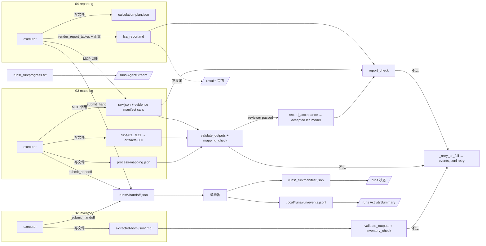

# 运行产物与调试记录

> **v5**：现行 workspace 布局与 revise-lca 版本文件（`<name>.rev<N>.<ext>`）见 `docs/refactor/v5/ARTIFACTS.md`。

Workspace 磁盘布局见 `docs/PROJECT_LAYOUT.md`（`workspace/runs/`、`workspace/artifacts/`）。本文说明每次运行在 `.local/runs/<run_id>/` 下留下什么，以及怎么查。`.local/` 已在 `.gitignore` 里，`workspace` 清理（`whole-lca` 等预设）不碰它，所以这些记录按运行保留。

## 目录

```text
.local/runs/<run_id>/
  events.jsonl               Pi 活动事件 + 编排器事件（含 injection_check / injection_summary）
  injection-summary.json     运行结束时写：会话数、最差等级、全部 mismatch 列表
  pi/<session_key>.mcp.log   MCP 子进程日志
  pi/<session_key>.guard.jsonl  路径守卫记录（拦截与越界）
  sessions/<stage>.<role>.<attempt>/
    prompt.md                最终拼好的完整提示词；每段前有注释：来源文件、默认版/用户版、哈希
    spec.json                作为首段上下文注入的 get_spec() 结果
    tools.json               pi-runtime 反报的、实际暴露给模型的工具名和 schema
    permissions.json         本会话生效的路径与工具白名单
    launch.json              模型、MCP 配置、环境变量名（只有名字）、各项哈希
    transcript.jsonl         完整对话记录（见下）
    transcript.blobs/        单条超过 1 MB 的记录全文
    injection/
      intended.json          宿主打算注入的内容
      effective.json         pi-runtime 从 SDK 真实状态读回的内容
      diff.json              逐项比对结果
      first_request.json     第一次请求模型时的实际 payload（脱敏），以及是否含注入的 system prompt
```

同一个 assignment 在一次运行里复用一个 Pi 会话；返工时（attempt 2、3…）会建新的会话目录，transcript 里早于本 attempt 的记录标 `scope: "earlier_attempt"`。

## 注入清单

- **intended.json（宿主）**：system prompt 全文和哈希；分段 `segments`（`spec_context`、运行协议、运行上下文、每条规则、提交说明、生成式提示词、知识资料），每段写明来源、`origin`（`builtin` / `runtime` / `default` / `user` / `generated`）、文件哈希和内容哈希；首条 user 提示词（第一轮开始时补上）；模型和参数；权限；工具白名单；MCP 配置（环境变量只写名字）；skills；extensions。分段正是 `build_prompt` 实际拼出的段落，按空行连接就是发出去的提示词（有测试保证）。
- **effective.json（pi-runtime）**：会话建好、第一次调模型之前，从 SDK 读：生效的 system prompt 全文（含 SDK 自己加的部分）、实际模型、工具名和 schema、MCP 工具是否注册及 exposure、已加载的 skills/extensions、路径守卫钩子是否挂上、首请求钩子是否挂上。mock 模式下 `captured: false`，不会伪造。
- **first_request.json**：SDK 的 `before_provider_request` 钩子在第一次请求模型时记录 payload（脱敏）。记录的是本项目扩展看到的 payload，排在后面的扩展若再改，不在其中。
- **diff.json**：逐项比对，分 `ok` / `warn` / `mismatch`。计划了但没生效、生效了但不在计划里、哈希对不上，都会列出。关键项：模型、spec_mcp 工具、路径守卫钩子。SDK 在注入内容前后追加的文字记为 `ok / sdk_added`。

**策略**：默认只记录、不中断。设置 `HARNESS_INJECTION_STRICT=1` 时，关键项 mismatch 会让会话启动失败；这个开关给测试和 doctor 用。已有硬拦截（如 MCP 工具等待 90 秒超时）不变。

**暂停后恢复（同 run_id checkpoint）**：恢复时若运行指纹（规则、模板、偏好、spec、实现代码）变了，默认不拒绝，在 `events.jsonl` 记一条 `injection_check`（`phase: resume`，`level: warn`），逐项列出变化的指纹路径和新旧值，然后按新配置继续；旧的 `runtime-config.json` 改名为 `runtime-config.prev-<n>.json`。严格模式下仍拒绝。worker 或模型变化、运行配置缺失，照旧拒绝。

**从阶段 N 续跑（`resume-lca`）**：失败/中止/中断的运行可从阶段 02/03/04 重新开一条新 `run_id`，沿用 N 之前已通过审查的阶段产物。每次新运行启动时在 `workspace/runs/_run/evidence/<run_id>/workflow.yaml` 与 `.local/runs/<run_id>/workflow.yaml` 保存当时使用的装配图原文；续跑优先读旧运行的快照生成 `workspace/runs/_run/resume/<old_run_id>/workflow.yaml`（`id: resume-lca`，阶段截断为 N..04）。清理走 `clean.py --cleanup-list`（只删清单内 workspace 路径 + journal 中的 openLCA UUID）；`runs/_run/evidence/<old>/`、`runs/_run/resume/` 与编排器锁库不删。新运行在 `runs/_run/evidence/<new>/resume.json` 与 `runs/_run/manifest.json` 记录 `resumed_from` / `resume_from_stage`；从 04 续跑时预置 `accepted["lca.model"]`（或 `runs/<stage>/accepted.json` 种子）。续跑中返工不得指向 N 之前的阶段。

## transcript.jsonl

由 pi-runtime 从 Pi SDK 自己的会话文件（`SessionManager.open` 写的 JSONL）导出，再补上只有实时事件流知道的内容；不从 `events.jsonl` 摘要拼凑。每轮结束和会话释放时重新导出。每行一个对象，`type` 为：

| type | 内容 |
|---|---|
| `header` | Pi 会话头 |
| `system` | 实际生效的 system prompt 全文 |
| `message`（user） | 全文 |
| `message`（assistant） | 文本、thinking（提供方返回时）、工具调用（完整参数）、provider/model、token（输入、输出、缓存读写）、耗时、停止原因、错误 |
| `tool_result` | 工具名、调用 id、完整结果、是否出错、耗时 |
| `entry` | 其他 SDK 条目（模型切换、压缩等）原样保留 |
| `turn` | 每轮开始/结束时间、耗时、状态、错误 |
| `retry` | SDK 自动重试的开始/结束 |
| `summary` | 消息与工具调用计数、模型、总 token 和本 attempt 的 token、交卷结果（handoff 的 status） |

超过 1 MB 的记录写进 `transcript.blobs/NNNN.json`，jsonl 里只留带 `blob` 和 `bytes` 的引用。

## 脱敏

所有快照写盘前统一脱敏：键名像密钥的字段（key、token、secret、password、authorization、signing…）直接替换；已知密钥值（敏感环境变量、MCP 环境里的 token、`.local/run/spec_mcp.key`、`.local/credentials/*.json` 里的值、`.env` 里的敏感项）和常见 token 模式（`sk-…`、`Bearer …` 等）在全文里替换为 `[REDACTED]`。有测试在环境里放假密钥和签名密钥，确认所有快照文件里都搜不到。

## 怎么查

- 命令行：
  - `npm run inspect` 列出所有运行；`npm run inspect -- <run> [--only-anomalies]` 按会话列注入异常；`npm run inspect -- <run> <stage.role.attempt>` 看单个会话的全部比对项和文件。
  - `npm run session -- <run>` 列出会话；`npm run session -- <run> <stage.role.attempt> [-o out.md] [--full]` 导出一份可读的 Markdown（注入、模型、完整对话），方便别的 agent 接手调试。
  - `npm run doctor`：检查生成式提示词模板能否渲染，并对正在运行的 pi-runtime 做一次空会话自检（只建会话、不调模型，比对后释放）。`--skip-runtime` 只查模板。
- GUI：结果页渲染 `workspace/artifacts/`、`workspace/runs/`（尝试目录与 handoff/review）以及 `workspace/runs/_run/`（运行摘要、progress、会话快照副本等）。运行结束时，本轮 `.local/runs/<run_id>/sessions/` 会复制到 `workspace/runs/_run/sessions/`。更早的运行仍留在 `.local/runs/`，用下面的命令查看，不在结果页列出。
- 接口：`GET /api/runs`、`GET /api/runs/{run}/sessions`、`GET /api/runs/{run}/sessions/{session}/injection`、`GET /api/runs/{run}/sessions/{session}/file?name=&download=`、`GET /api/runs/{run}/sessions/{session}/markdown?download=`。

## 生成式提示词

`harness/prompts/generated/*.md.tmpl` 每次建会话现场渲染（见 `harness/prompts/README.md`）。预览接口 `GET /api/prompts/generated/preview?stage=&role=` **只支持 `harness/workflows/LCA-main.yaml` 里的阶段**（修订工作流 `LCA-revise.yaml` 暂不支持）。

---

## 附录：产物地图（P5 合并前版本，基于 `ee78fc0`）

> 长期迭代文档：记录每个阶段产出什么、放在哪、谁写谁读、GUI 怎么显示、什么时候失效。重构中每次改动产物的路径、写入方或渲染方式，都要同步更新本文，并在末尾“变更记录”里记一笔。
>
> 本版依据 `master`（`ee78fc0`）的代码核对，路径均相对项目根目录。P5（`spec_mcp`，分支 `refactor/p5-spec-channels`）尚未合并，相关变化只在“已知问题与待优化”里预告。

### 1. 总表

| 阶段 / 层级 | 产物 | 路径 | 格式 / 契约 | 写入方 | 校验 / 读取方 | GUI |
| --- | --- | --- | --- | --- | --- | --- |
| 01 reviewer | 交卷 handoff | `workspace/runs/01-intake-gate/reviewer-<n>/handoff.json` | JSON，`handoff.py` + `harness/specs/shared/lca-handoff-extension.schema.json` | agent 调 `lca_artifacts.submit_handoff` | 编排器 `advance()` | 仅事件流里的“已交卷”徽标 |
| 01 | 审查记录 | `workspace/runs/01-intake-gate/reviewer-<n>/review.md` | Markdown | 宿主 `write_review_note` | 人工 | 不显示 |
| 02 executor | BOM 清单 | `workspace/runs/02-inventory-extraction/<role>-<n>/extracted-bom.json` → `workspace/artifacts/extracted-bom.json` | JSON，`harness/specs/02-inventory-extraction/extracted-bom.schema.json`，顶层 `items[]` | agent 直接写文件 | `validate_outputs`（schema）→ host action `inventory_check`（`checks.inventory_errors`）→ 02 reviewer；03、04 读取 | 不显示 |
| 02 executor | BOM 说明 | 尝试目录内 `extracted-bom.md` → `workspace/artifacts/extracted-bom.md` | Markdown（仅非空检查） | agent | `validate_outputs`、reviewer | 不显示 |
| 03 executor | 过程映射 | 尝试目录内 `process-mapping.json` → `workspace/artifacts/process-mapping.json` | JSON，`harness/specs/03-dataset-mapping/process-mapping.schema.json`，顶层 `items[]` | spec_mcp `submit` | schema → `mapping_check`（`checks.mapping_errors`，含 provider 正式证据）→ reviewer；04 读取 | 不显示 |
| 03 executor | LCI 数据集 | 尝试目录内 `LCI/{flows,processes,product_systems}/` → `workspace/artifacts/LCI/` | openLCA JSON-LD 目录（只检查“是目录”） | agent | `mapping_check`、04 的 `import_lci` | 不显示 |
| 03 reviewer 通过后 | 模型验收记录 | `workspace/runs/_run/evidence/<run>/manifest.json` 的 `accepted["lca.model"]`；阶段 `runs/03-dataset-mapping/accepted.json` | JSON | host action `record_acceptance` | 04 工具 `require_approved_model`、`get_rework_status` | 不显示 |
| 04 executor | 计算计划 | 尝试目录内 `calculation-plan.json` → `workspace/artifacts/calculation-plan.json` | JSON（无 schema，`require_calculation_plan` 检查目标/方法各出现一次） | agent | `calculate_product_system` 前置检查；进入计算指纹 | 不显示 |
| 04 executor | LCA 报告 | 尝试目录内 `lca_report.md` → `workspace/artifacts/lca_report.md` | Markdown，表格由 `render_report_tables` 生成 | MCP `lca_artifacts.render_report_tables` 生成表格 + agent 补正文 | `report_check`（证据 + 表格一致性 + 中文提示）→ reviewer | 不显示 |
| 各执行者 | MCP 调用原始结果 | `workspace/runs/<stage>/<role>-<n>/raw/<call_id>/raw.json` | JSON（领域结果全文） | MCP（`store.save_result`） | `checks.*` 经 manifest 引用 | 不显示 |
| 各执行者 | 调用清单 / 证据 | `workspace/runs/_run/evidence/<run>/manifest.json`（`calls[]`、`accepted{}`、`invalidations[]`） | JSON，每条带 `model_fingerprint`、`calculation_fingerprint` | MCP 追加 `calls`；宿主写 `accepted`、`invalidations` | `checks.py` 全部证据判断 | 不显示 |
| 检查结果 | 检查记录 | `workspace/runs/_run/evidence/<run>/checks/{inventory,mapping,report}.json` | JSON，含 `checker_version`、冻结的 `inputs` 指纹 | `checks.validate_for_run` | `validation_state`（过期则改写为 `stale`） | 不显示 |
| 03/04 | 导入预检回执 | `workspace/runs/<stage>/<role>-<n>/import-operations/preflights/<preflight_id>.json` | JSON | `control_openlca` MCP（`operations.py`） | `import_lci` 引用 preflight | 不显示 |
| 运行级 | 运行摘要 | `workspace/runs/_run/manifest.json` | JSON：`status`、`current_stage`、`status_reason`、`run_id` | 编排器 `publish_state` | `GET /api/workflow/manifest`、progress/activity 接口取 run_id | `/runs` 状态 |
| 运行级 | 检查点 | `workspace/runs/_run/orchestrator.sqlite`（+ `orchestrator.lock`） | SQLite | `CheckpointStore` | 断点续跑 | 不显示 |
| 运行级 | 运行配置指纹 | `workspace/runs/_run/evidence/<run>/runtime-config.json` | JSON：实现、rules、tools、knowledge、各阶段 spec + schema 的哈希 | 编排器 | 续跑时比对 | 不显示 |
| 运行级 | 工作流快照 | `workspace/runs/_run/evidence/<run>/workflow.yaml`（镜像 `.local/runs/<run>/workflow.yaml`） | 开跑时**当时生效**的 workflow YAML 原文（含 `.local/harness/workflows` 副本） | 编排器 `write_workflow_snapshot`；`runs/_run/manifest.json` 的 `workflow_snapshot` 指向相对路径 | 同 run 断点续跑读快照，不读当前 `.local`；`resume-lca` 资格校验 | 不显示 |
| 续跑计划 | 续跑元数据 | `workspace/runs/_run/resume/<old_run_id>/{workflow.yaml,cleanup.json,plan.json}`（镜像 `.local/runs/<old_run_id>/resume/`） | 过滤后的 `resume-lca` 装配、删除清单、摘要 | `resume_plan.build_plan` | `POST /api/workflow/resume` | 不显示 |
| 续跑运行 | 续跑来源 | `workspace/runs/_run/evidence/<new_run>/resume.json`；`manifest.json` 的 `resumed_from` / `resume_from_stage` | JSON | 编排器 `--resumed-from` / `--from-stage` | 运行历史、排障 | `/runs` 续跑 UI |
| 运行级 | 上游返工记录 | `workspace/runs/_run/rework/upstream-<n>.json` | JSON：`stale_stages`、`reason`、`at` | 编排器 `_invalidate_stages` | 人工 | 不显示 |
| 运行级 | 进度文本 | `workspace/runs/_run/progress.txt` | 带标签的文本块 | `pi_client` 活动处理 + 编排器 | `GET /api/workflow/progress` | `/runs` 的 `AgentStream` |
| 每个 turn | 排障快照 | `workspace/runs/_run/logs/<stage>/<assignment>#<attempt>/`：`prompt.md`、`session-config.json`、`argv.json`、`stdout.jsonl`、`session-ref.json`、`rendered-manifest.json` | 文本 / JSON | `core/agents/archive.py` | 人工排障 | 不显示 |
| 每个 turn | MCP 渲染配置 | `workspace/tmp/mcp-render/<run>/<stage>/<assignment>/` | 配置文件 | `archive.mcp_render_dir` | pi-runtime | 不显示 |
| 运行级 | 结构化事件 | `.local/runs/<run>/events.jsonl` | JSONL：worker 的 `tool_call`/`tool_result`/`text`/`turn_end`/`permission`；编排器的 `retry`/`rework_upstream`/`fault_injected`（`source: orchestrator`） | `pi_client` + 编排器 `_emit` | `GET /api/workflow/activity`（+ `/stream`） | `/runs` 的 `ActivitySummary` |
| 每个会话 | 路径拦截日志 | `.local/runs/<run>/pi/<session_key>.guard.jsonl` | JSONL：`tool`、`action`、`requested_path`、`resolved_path`、`reason` | pi-runtime `session_host.ts` | 人工 / 巡检 | 不显示 |

### 2. 按阶段说明

#### 01-intake-gate（只有 reviewer）
- 输入：`workspace/artifacts/plan/main_plan.md`。`spec.yaml` 中 `outputs: []`、`acceptance.checks: []`。
- 唯一产物是 reviewer 的 handoff 和宿主写的审查记录。

#### 02-inventory-extraction
- executor 写 `extracted-bom.json`、`extracted-bom.md`，交 handoff。
- 宿主依次跑：`validate_outputs`（存在、非空、JSON、schema）→ `inventory_check`（`checks.inventory_errors`：行结构、来源 ID 是否在声明的知识来源中）。不过则 `_retry_or_fail`，在 `events.jsonl` 记 `retry`。
- reviewer 只读审查；reviewer 判 passed 后，`_guard_reviewer_passed` 会再跑一次产物契约和检查。

#### 03-dataset-mapping
- executor 写尝试目录内的 `process-mapping.json` 和 `LCI/`，并通过 `control_openlca` 调 `validate_providers_batch` / `preflight_import_lci`，调用结果进 `raw/` 与 manifest。
- `mapping_check` 只认**当前模型指纹**下的 provider 验证调用；LCI 或 mapping 改动后旧证据作废。
- reviewer 通过后执行 `lifecycle.on_reviewer_passed` 的 `record_acceptance`，把冻结输入写进 `accepted["lca.model"]`。

#### 04-openlca-reporting
- executor 写 `calculation-plan.json`，调 `import_lci`、`get_model_graph`、`calculate_product_system`（结果进 raw.json / manifest），再调 `render_report_tables` 生成 `lca_report.md` 的表格并补正文。
- `report_check` = `report_evidence_errors`（证据必须基于已验收模型、当前计算计划）+ `report_table_errors`（报告表格与证据一致）+ 语言提示。
- executor 交 failed 并带 `model_changed` / `rework_target_stage` / `rework_artifacts` 时，编排器核对后退回上游（见 §4）。

### 3. GUI 现状

| 页面 / 组件 | 接口 | 数据源 | 显示内容 |
| --- | --- | --- | --- |
| `/runs` → `ActivitySummary`（`components/runs/activity-summary.tsx`） | `GET /api/workflow/activity` | `.local/runs/<run>/events.jsonl` | 每个 assignment 的工具次数、错误数、最后工具、交卷状态 |
| `/runs` → `AgentStream`（`components/runs/agent-stream.tsx`） | `GET /api/workflow/progress` | `progress.txt`（准备阶段用启动器的内存文本） | Agent 正文、工具调用、编排器提示 |
| `/runs` 状态 | `GET /api/workflow/manifest` / progress | `workspace/runs/_run/manifest.json` | 运行状态、当前阶段、失败原因 |
| `/results`（`app/results/page.tsx`） | 无 | — | 只有一句写死的路径说明，**不展示任何产物** |
| `/harness` | `GET /api/harness/catalog`、`/api/harness/document` | `harness/` 下文件 | 规则、spec、schema 原文（是配置，不是产物） |

GUI **不显示**：BOM、mapping、LCI、计算计划、报告正文、raw.json、证据 manifest、检查记录、handoff 内容、审查记录、返工记录、guard 日志、turn 快照。

### 4. 生命周期

- **跨运行**：控制面板的 whole-lca / revise-lca 预设在执行前清理 `workspace/runs/`（保留 `orchestrator.lock` 与 `**/README.md`）、`workspace/artifacts/`、`workspace/tmp/`；whole-lca 还会 **整目录**删掉遗留的 `workspace/outputs/` 与 `workspace/records/`（含其中被 git 跟踪的 README，不单独保留）。清理顺序见 `workspace_clean.py`（whole-lca 先清 openLCA，成功后才清 workspace；revise/resume 不清 workspace）。所以 `workspace/` 只保留**最近一次运行**的可浏览产物；`.local/runs/<run>/`（events、guard）不在清理范围内，跨运行保留。预设**不清理 `harness/knowledge/`**。
- **从阶段续跑（`resume-lca`）**：仅当 workspace 当前 `manifest.json` 的 `run_id` 对应一次 `failed` / `aborted` / `interrupted` 运行，且计划与 inputs 相对旧运行验收快照未变。`GET /api/runs/{id}/resume-preview` 返回精确删除清单；`POST /api/workflow/resume` 先 `build_plan`，再按清单清理（不碰 `harness/knowledge`、`.local` 历史），然后以过滤后的 `resume-lca` YAML 启动新 run。阶段 N 之前的产物与 handoff 沿用；续跑运行内若 reviewer 返工指向 N 之前的阶段，编排器拒绝（`validate_upstream_request`）。
- **同一运行内的重试**：各阶段尝试目录 `workspace/runs/<stage>/<role>-<n>/` 独立；交付物在尝试目录内写入，审查通过后复制到 `workspace/artifacts/`；handoff 与 review 随尝试目录保留；`raw/` 按 call_id 分目录，manifest `calls[]` 只追加。
- **上游返工**：`_invalidate_stages` 把目标阶段到当前阶段标为 `stale_stages`，写 `workspace/runs/_run/rework/upstream-<n>.json`，从 evidence manifest 的 `accepted` 中删掉这些阶段记下的验收并追加 `invalidations`。产物**留在原处**由目标执行者修改，不移动不删除。attempt 编号经 `stage_attempt_base` 继续递增，旧 handoff 不被覆盖。
- **指纹**：
  - `runtime-config.json`：实现代码（`src/backend/core`、`settings.py`、`harness/tools`）、rules、tools、knowledge 内容、各阶段 `spec.yaml` 及其引用的 schema。
  - `model_fingerprint`：LCI 文件 + BOM + mapping（`checks.upstream_files`）的内容哈希；`calculation_fingerprint`：`calculation-plan.json` 哈希。两者写进每条 manifest `calls[]`，决定证据是否仍有效。
  - 报告、BOM 说明、examples 不进入运行配置指纹。

### 5. 流程图



### 6. 已知问题与待优化

1. **（部分解决）结果页**：`/results` 读取 `workspace/artifacts/`、`workspace/runs/` 与 `workspace/runs/_run/`；更早的运行仍在 `.local/runs/`。
2. **“已交卷”状态串到下一次 attempt**：`activity-summary.tsx` 在 attempt 递增时执行 `if (entry.handoff !== "ok") entry.handoff = "none"`，上一 attempt 的 `ok` 会保留，所以 04 第 2 次还没交卷也显示“已交卷”（巡检报告过的现象）。
3. **编排器事件没被页面使用**：`retry`、`rework_upstream`、`fault_injected` 已写进 `events.jsonl`，但 `ActivitySummary` 只处理 `tool_call`/`tool_result`/`turn_end`，重排和退回原因在 GUI 上看不到。
4. **guard 日志、handoff、审查记录、返工记录都不展示**，排障全靠读文件。
5. **时间格式不一致**：`events.jsonl` 用 ISO UTC（`...Z`），`rework/upstream-<n>.json` 的 `at` 用本地时间 `%Y-%m-%dT%H:%M:%S%z`。
6. **`records/README.md` 过时**：列出的 `stages/` 目录代码里没有写入方，`evidence/`、`rework/`、`import-operations/` 没写进去。
7. **`outputs/reports/` 下的 `raw/`、`model_graph/`、`lca-quality/` 目录**在实际工作区里存在，但 master 代码里没找到写入方，可能是旧版本遗留，待确认后清理或补文档。
8. **部分交付物没有 schema**：`calculation-plan.json`、`lca_report.md`、`extracted-bom.md`、LCI 目录只做存在/非空检查，结构靠提示词和下游检查兜底。
9. **（已解决，P5 已合并：正式交付经 `spec_mcp` 的 `submit` 写盘；§1、§2、§5 仍待按 P5 更新）写入方分散**：02/03 的 JSON 交付由 agent 直接写文件，04 报告由 MCP + agent 混写，验收证据由 MCP 写、验收结论由宿主写。P5 `spec_mcp` 会把正式交付改为经 `submit` 写盘（spec 中 `writer: spec_mcp`），并把 schema 与 acceptance 前移到提交时；合并后本文 §1、§2、§5 需要整体更新。
10. **跨运行历史只有 `.local/runs`**：`workspace/` 每次被预清理，旧运行的产物、handoff 不保留；若 GUI 要做“历史结果”，需要先定归档位置。

### 7. 变更记录

| 日期 | 基于提交 | 变更 |
| --- | --- | --- |
| 2026-10-10 | `ee78fc0`（master） | 初版：按代码盘点四个阶段的产物、写入/校验方、GUI 渲染、生命周期与指纹，列出 10 条待优化项 |
| 2026-10-11 | P5 合并进 master | 与 P5 版调试记录合并为一个文件；产物地图保留为附录，第 1、9 条标注进展 |
| 2026-10-14 | 预清理不再清 knowledge | 预设去掉 knowledge；计划原子替换；参考资料只增不删，同名拒绝上传 |
