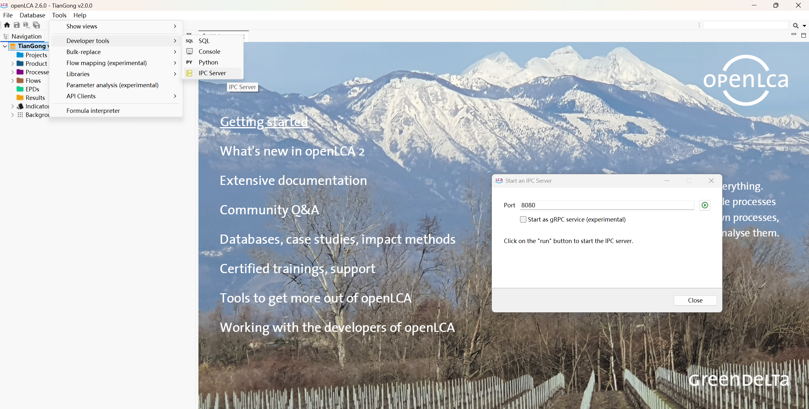

# openLCA 连接

每次运行前：

1. 打开 openLCA Desktop，打开目标数据库。
2. 启用 IPC Server（默认 `127.0.0.1:8080`；端口可在「项目状态」修改）。

然后在「项目状态」确认 openLCA 一项为就绪，并显示数据库名。「LCA 计划」页右上角也会显示连接状态。

运行中代理只会在项目分类 `202606-harness-agent-LCA` 下新建或删除 flow、process、product system；
数据库里的背景数据只读，不会被改动。需要清理时，只删这个分类下的内容。
