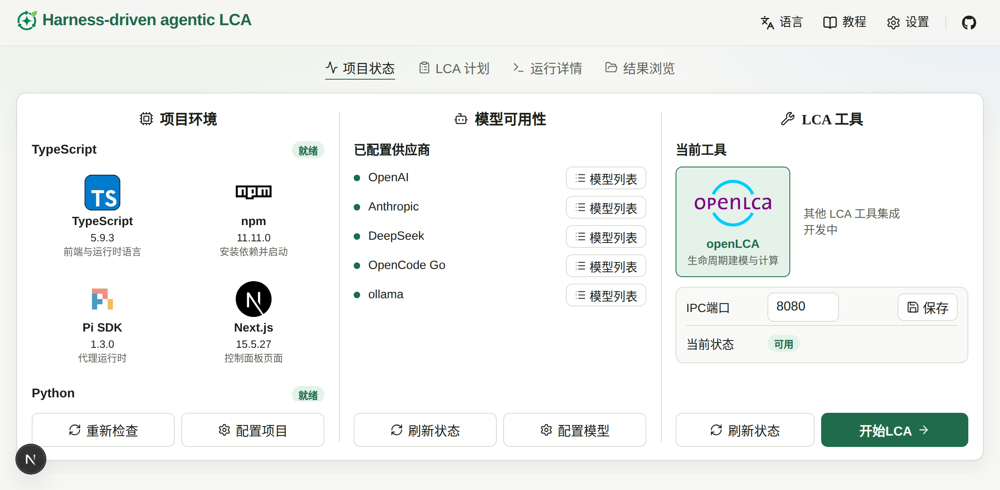
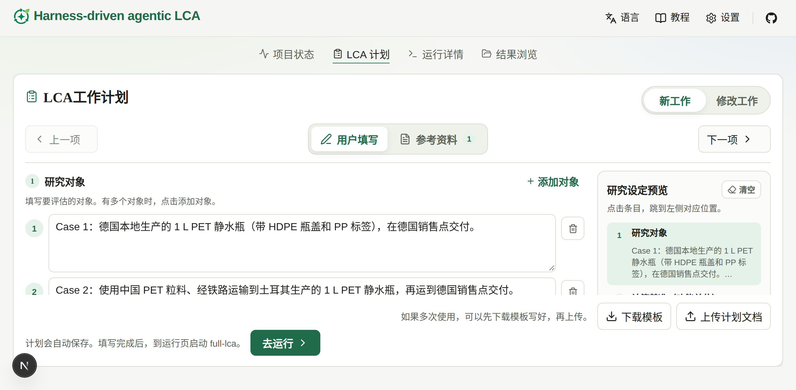
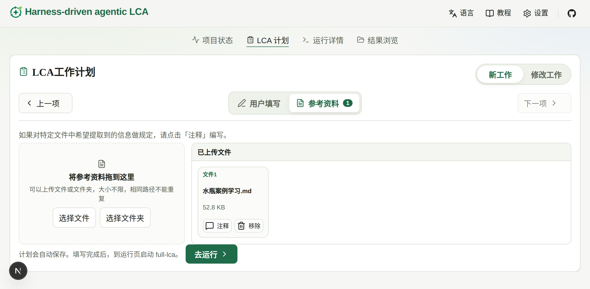
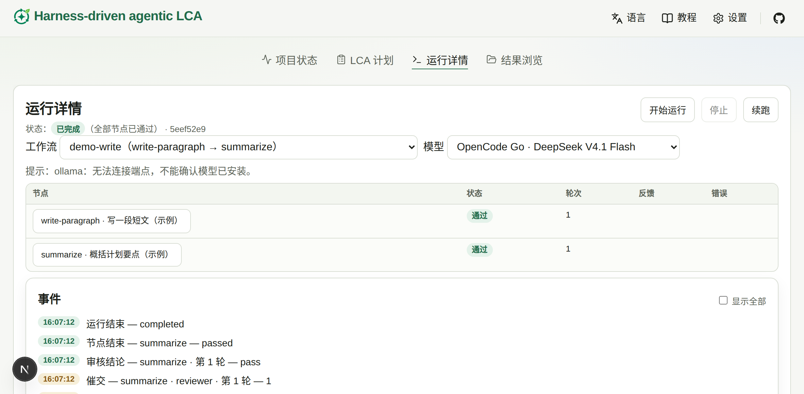
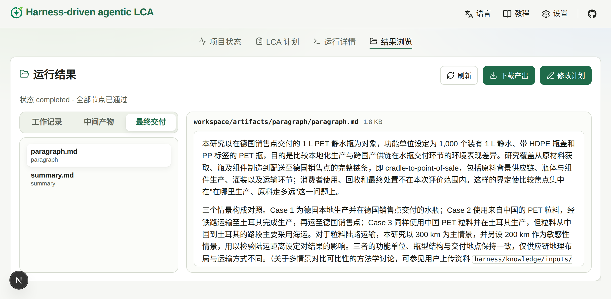

# 教程首页

这一页是完整的操作流程：检查环境 → 填写计划 → 运行 → 查看结果 → 修订。

## 项目状态检查

从左到右的三个子面板：

### 1. 检查环境

「项目环境」里 TypeScript 和 Python 都显示「就绪」。未就绪时点「重新检查」。一般不会出问题，如有问题需要考虑退出项目重新安装环境（可以询问 AI 如何开展）

### 2. 配置模型

同一页的「模型可用性」应列出已配置供应商。还没有时，点「配置模型」。
在顶栏「设置」的「模型」里展开要用的供应商，填写密钥，点「保存密钥」。要用自建或本地接口时，在下方「自定义 API / 本地模型」里添加并保存。

### 3. openLCA 状态确认

确认 openLCA 是否有效连接。桌面端怎么打开数据库、怎么启用 IPC，按 [openLCA 连接](basics/openlca.md) 做。

## LCA 计划填写

### 1. 手动填写计划内容

进入「LCA 计划」，右上角工作类型选「新工作」，停在「用户填写」。

用户根据需求填写内容，计划会自动保存。同一类研究要反复填写时，可以先「下载模板」，写好后再「上传计划文档」。

### 2. 添加文件

打开「参考资料」。把工艺说明、用量表等拖进上传区，或点「选择文件」「选择文件夹」。同一路径不能重复。

若希望从某份文件里只取特定内容，点该文件的「注释」，写明后保存。

### 3. 去运行

计划和参考资料准备好后，点页面下方的「去运行」，进入「运行详情」。

## 运行详情

1. 「工作流」选 full-lca（清单 → 映射 → 报告 的完整流程，先做 intake 检查）。
2. 「模型」选本次使用的模型（需先在「设置」里配好供应商）。
3. 点「开始运行」。节点表实时显示每个节点的状态、轮次和错误；点节点名可看该节点的交付要求、代理配置和事件。
4. 下方「事件」列出催交、提交被拒、审核结论、停止等关键事件。
5. 需要时点「停止」；之后点「续跑」，已通过的节点不会重跑。

每个节点由执行者产出、审核者给出「通过」或「退回」；退回会带着反馈进入下一轮，反馈可在节点表的「反馈」列查看。

## 查看最终文件

运行结束后，打开「结果浏览」，切到「最终交付」。这里是报告、计算计划和清单，点开即可阅读。

每个节点每一轮的提交和审核结论在「工作记录」。flow、process、product system 等在「中间产物」。

## 修改已有结果（修订）

在「结果浏览」点「修改计划」，或在「LCA 计划」把工作类型切到「修改工作」，写下要改的内容（例如某个情景的运输距离、报告里要补的说明）。
然后「去运行」，工作流选 revise-lca，点「开始运行」。修订会依次做清单修订、映射修订和报告修订；上一轮的产出保存在
`artifacts/previous/`，在「结果浏览」的「上一版」里对照查看。
