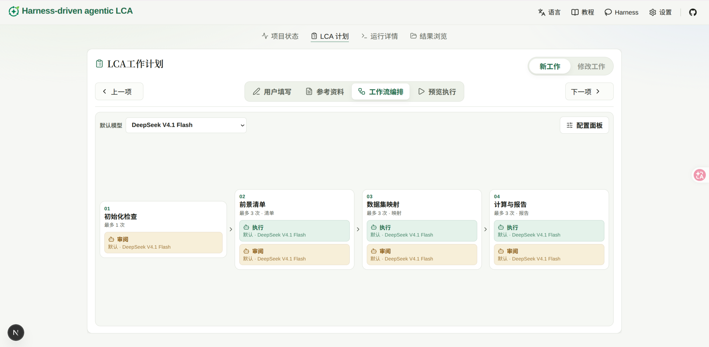
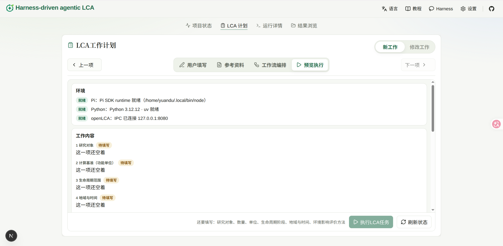

# 教程首页

这一页是目前可以照着做完的操作流程。左侧其他教程还在补充。

## 项目状态检查

从左到右的三个子面板：

### 1. 检查环境

「项目环境」里 TypeScript 和 Python 都显示「就绪」。未就绪时点「重新检查」。一般不会出问题，如有问题需要考虑退出项目重新安装环境（可以询问 AI 如何开展）

### 2. 配置模型

同一页的「模型可用性」应列出已配置供应商。还没有时，点「配置模型」。
在设置的「模型」里展开要用的供应商，填写密钥，点「保存密钥」。要用自建或本地接口时，在下方「自定义 API / 本地模型」里添加并保存。

### 3. openLCA 状态确认

确认 openLCA 是否有效连接。桌面端怎么打开数据库、怎么启用 IPC，按 [openLCA 连接](basics/openlca.md) 做。

## LCA 计划填写

### 1. 手动填写计划内容

进入「LCA 计划」，右上角工作类型保持「新工作」（「修改工作」正在开发），停在「用户填写」。

用户根据需求填写内容。同一类研究要反复填写时，可以先「下载模板」，写好后再「上传计划文档」。

### 2. 添加文件

打开「参考资料」。把工艺说明、用量表等拖进上传区，或点「选择文件」「选择文件夹」。同一路径不能重复。

若希望从某份文件里只取特定内容，点该文件的「注释」，写明后保存。

### 3. 配置工作流

打开「工作流编排」。

通过设置默认模型或者点击单个 agent 的图标，当前可以对工作流步骤中每个 agent 使用的模型进行配置（需要在之前的工作中配置好对应供应商）。

未来将进一步进行功能开发，使用户可以自行对每一步工作中的编排顺序、调用工具、规则提示词、交付产物等进行灵活定制，从而对 agent 能够实现更加有效的 **harness**。

### 4. 检查并运行

打开「预览执行」。

环境里 Pi、Python、openLCA 都是「就绪」，工作内容没有「待填写」。系统会自动检查当前输入内容是否满足工作运行要求。底栏出现「环境和工作内容已齐，可以执行」后，点「执行LCA任务」。

未就绪时按钮保持禁用。按底栏提示补环境或漏填项，然后点「刷新状态」。

## 运行详情

agent 工作时，此处可以看到实时更新的具体工作内容。

## 查看最终文件

运行结束后，打开「结果浏览」，切到「最终交付」。这里是报告、计算计划和清单，点开即可阅读。

过程中的交接和日志在「工作记录」。flow、process、product system 等在「中间产物」。

